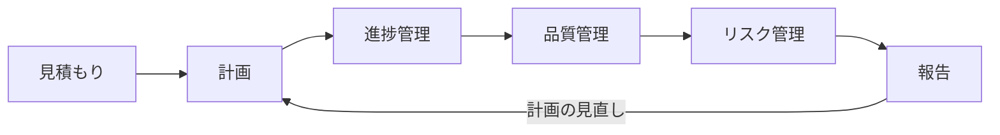

# 00-01 案件の進め方

!!! abstract "到達目標"
    - 見積もり・計画・進捗・品質・リスク・報告の流れと、それぞれの目的を説明できる
    - 課題管理ツールの課題とバーンダウンチャートから、遅れの兆候を読める
    - レビュー指摘を分類・集計し、改善につなげる考え方を説明できる
    - 事実・見通し・対策・相談を分けた報告を書ける

## 何か

案件の進め方（プロジェクトマネジメント）とは、決められた期間と人数で、
求められた品質のものを届けるために、計画し、状況を測り、手を打つ活動です。
この章では、次の 6 つを順に扱います。



| 活動 | 問い | 主な成果物 |
|---|---|---|
| 見積もり | どれだけの作業か | 作業の一覧（WBS）と工数 |
| 計画 | いつ・だれが・どの順で | マイルストーン、課題（チケット）、担当 |
| 進捗管理 | 予定どおりか | 課題の状態、バーンダウンチャート |
| 品質管理 | 求められた品質か | テスト結果、カバレッジ、レビュー指摘の分析 |
| リスク管理 | 何が起きそうか | リスク一覧（影響・確率・対策・期限） |
| 報告 | 何を伝え、何を決めてもらうか | 週次の報告 |

## なぜ必要か

- 遅れや品質の問題は、気づくのが遅いほど取り戻すのが難しくなります。早く気づくには「測る仕組み」が要ります
- 関係者（顧客・上長・他チーム）は、正確な状況が分からないと判断できません
- 「頑張れば何とかなる」は計画ではありません。根拠のある見通しが、無理な残業や品質の低下を防ぎます

## どうやるか

### 1. 見積もり

1. 成果物から作業を分解する（WBS: Work Breakdown Structure）。1 つの作業は 0.5〜3 日程度に収める
2. 作業ごとに工数を見積もる。過去の実績（似た規模の API・バッチにかかった日数）を根拠にする
3. 不確実さを幅で示す（例: 「8〜12 人日」）。前提（設計書の確定日、環境の準備など）も書く
4. 見積もりに含めないもの（範囲外）を明記する

!!! failure "悪い例"
    「API 10 本で 10 人日」と 1 行だけ書く。設計・単体テスト・Karate・レビュー・手戻りの工数が抜け、前提も書かれていません。

!!! success "良い例"
    API 1 本を「設計確認・実装・単体テスト・API テスト・レビュー対応」に分け、過去の実績から 1 本あたりの幅を出す。
    前提（設計書が確定していること）と範囲外（性能試験）を併記する。

### 2. 計画

1. マイルストーン（中間目標。例: 「製造完了」「結合テスト完了」）と日付を決める
2. WBS の作業を、課題管理ツール（Backlog など）の **課題（チケット）** として登録する
3. 各課題に、担当者・開始日・期限・見積もり工数・マイルストーンを入れる
4. 作業の順番（前提となる作業）と、担当者の負荷の偏りを確認する

課題の粒度は、「完了したかどうかを誰が見ても判断できる」大きさにします。
完了の条件（例: 「PR がマージされ、CI が通っている」）をチームで決めておきます。

### 3. 進捗管理（課題管理とバーンダウン）

日々の進捗は、課題の状態（未対応・処理中・処理済み・完了）で把握します。
課題の状態を毎日更新することが、すべての数字の前提です。

**バーンダウンチャート** は、マイルストーンの残作業量を縦軸、日付を横軸にとったグラフです。

- 理想線: 開始日の総量から期限の 0 まで、まっすぐ減る線
- 実績線: 実際の残作業量

| 実績線の形 | 読み方 | 打つ手の例 |
|---|---|---|
| 理想線の下 | 予定より進んでいる | 後続の作業の前倒しを検討 |
| 理想線の上で、差が広がる | 遅れが拡大している | 原因を特定し、範囲・人員・期限のどれを動かすか相談 |
| 平らなまま | 完了にならない課題が多い（課題が大きすぎる、状態の更新漏れ） | 課題を分割する、更新を徹底する |
| 途中で上がる | 作業が追加された | 追加の理由と影響を報告する |

あわせて、次の課題を毎日確認します。

- 期限を過ぎた課題、期限が近い課題
- 開始日を過ぎても未着手の課題
- 担当者ごとの残作業（負荷の偏り）

!!! tip "レポートは自動で作る"
    課題管理ツールの API から、マイルストーンごとの完了率・期限超過・バーンダウンを集計する
    進捗レポートの仕組み（backlog-report）があります。
    手で集計する時間を減らし、その分を「原因の分析と打ち手」に使ってください。

### 4. 品質管理（レビュー指摘の分析）

品質は、テストとレビューの結果を **数字で** 見ます。

| 見るもの | 例 | 分かること |
|---|---|---|
| テスト | 単体テストの件数と成否、カバレッジ（JaCoCo） | テストの量と、通っていない箇所 |
| CI | ビルドの成功率、失敗から復旧までの時間 | 壊れた状態が放置されていないか |
| レビュー指摘 | 件数、成果物ごとの密度、指摘の種類 | どこに、どんな欠陥が多いか |

レビュー指摘は、集めて → 分類して → 傾向を見る、の順で分析します。

1. 集める: 指摘表や PR のコメントから、指摘を 1 件 1 行のデータにする
2. 分類する: 指摘の種類（仕様の誤り・例外処理の漏れ・命名・表記など）と、真因（なぜ作り込んだか）を付ける
3. 傾向を見る: 種類別・成果物別・工程別に件数と割合を出し、前回と比べる

| 傾向 | 打ち手の例 |
|---|---|
| 特定の種類の欠陥が多い（例: 例外処理の漏れ） | 作成時のチェックリストに観点を追加する |
| 特定の成果物に集中している | 設計書のあいまいさを確認する、レビューを厚くする |
| 表記・好みの指摘が多い | 規約やフォーマッターで機械的に直し、レビューの時間を本質に使う |

!!! tip "分析も道具で補助する"
    指摘を集め、分類し、ダッシュボードにまとめる指摘分析の仕組み（quality-analytics）があります。
    分類の最終判断と、打ち手を決めるのは人です。

!!! warning "数字で人を評価しない"
    指摘件数を個人の評価に使うと、指摘が出にくくなり、数字が実態を表さなくなります。
    指摘は「作り方の仕組み」を改善するための材料として扱います。

### 5. リスク管理

リスクとは、まだ起きていないが、起きると計画に影響する事柄です。
起きてしまったものは「課題」として扱います。

| 項目 | 例 |
|---|---|
| 内容 | 外部 API の仕様確定が遅れる |
| 影響 | 結合テストの開始が 1 週間遅れる |
| 発生の可能性 | 中 |
| 対策 | 仕様が未確定な部分をモックで先に作る。確定の期限を相手と合意する |
| 担当・期限 | リーダー・今週金曜 |

リスク一覧は週に 1 回見直し、可能性や影響が変わったものを更新します。

### 6. 報告

報告では、**事実・見通し・対策・相談（決めてほしいこと）** を分けて書きます。

例:

```text
【進捗】マイルストーン「製造完了」: 完了率 60%（予定 70%）。会員 API は完了、注文取込バッチが 2 日遅れ。
【見通し】このままでは期限に 2 日遅れる見込み。
【原因】入力ファイルの形式の確認に想定より時間がかかった。
【対策】形式の確認は完了。今週はバッチに 1 名追加し、遅れを 1 日に縮める。
【相談】残り 1 日の遅れについて、期限の延長か、帳票出力を次のマイルストーンに回すかを判断いただきたい（期限: 水曜）。
【品質】単体テスト 全件成功。レビュー指摘は例外処理の漏れが多く、チェックリストに観点を追加済み。
【リスク】外部 API の仕様確定待ち（影響: 結合テスト開始の遅れ）。
```

!!! failure "悪い例"
    「概ね順調です。一部遅れていますが挽回します」。
    どれだけ遅れているか、挽回の根拠は何か、相手に何を決めてほしいかが分かりません。

!!! success "良い例"
    数字（完了率と予定）と、遅れの原因・対策・見通しを書き、判断してほしいことを期限付きで示す。

## サンプルアプリでは

sample-app は小さなアプリですが、品質を測る仕組みの例がそろっています。

- `sample-app/build.gradle` の `jacocoTestReport` で、テストのたびにカバレッジの HTML と XML を出力します。XML はツールで集計に使えます

```groovy
jacocoTestReport {
    reports {
        xml.required = true
        html.required = true
    }
}
```

- `dev-environment/.github/workflows/ci.yml` で、push と PR のたびにビルド・単体テスト・ローカル環境の起動・Terraform の書式を確認し、テスト結果を成果物（artifact）として保存します
- `sample-app/src/main/java/com/example/sample/common/MessageIds.java` のように、メッセージ ID（`APPE0002` など）を決めておくと、障害の報告や課題の起票で「どのエラーか」を正確に共有できます
- バッチの終了コード（0 正常 / 4 警告あり / 8 異常）は、運用の監視や報告の基準にそのまま使えます

これらの数字は、進捗報告の【品質】欄の根拠になります。
カバレッジや指摘の数字の読み方は [品質を測る](../60-quality/60-03-measure-quality.md) で詳しく学びます。

## もし進捗を測る仕組みがなかったら？

遅れは、各メンバーの「たぶん大丈夫」の積み重ねの中に隠れます。
マイルストーンの直前になって初めて遅れが分かり、残業と品質の低下で取り戻そうとすることになります。

品質についても、指摘を集計していなければ、同じ種類の欠陥を何度も作り込み、毎回レビューで直すことを繰り返します。
測る仕組みがあれば、早い段階で「範囲・人員・期限のどれを動かすか」を関係者と相談できます。

## 理解度チェック

1. バーンダウンチャートの実績線が、数日間まったく下がりません。考えられる原因を 2 つ挙げてください。
2. 「リスク」と「課題」の違いは何ですか。
3. レビュー指摘で表記・好みに関するものが多いとき、どんな打ち手が考えられますか。
4. 報告で「事実」「見通し」「相談」を分けるのはなぜですか。

??? note "答え"
    1. 課題が大きすぎて完了にならない、課題の状態の更新が漏れている、作業が止まっている（前提の作業待ちなど）、などです。
    2. リスクはまだ起きていないが起きると影響する事柄、課題はすでに起きている問題です。
    3. コーディング規約やフォーマッターで機械的に直せるようにし、レビューの時間を仕様や設計の確認に使えるようにします。
    4. 読み手が状況を正しく理解し、何を判断すればよいかがすぐ分かるようにするためです。事実と推測が混ざると、判断を誤ります。

## コードを読むときの確認観点

- [ ] 課題の完了条件（PR のマージ、CI の成功など）がチームで決まっているか
- [ ] CI でテスト結果とカバレッジが毎回出力され、だれでも確認できるか
- [ ] エラーにメッセージ ID が付いていて、報告や起票で特定できるか
- [ ] レビュー指摘が記録され、種類や真因で分類できる形になっているか
- [ ] 報告の数字が、課題管理ツールや CI の実データに基づいているか
