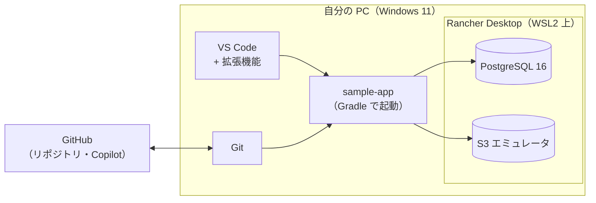

# 10-01 全体像と必要なソフト

!!! abstract "到達目標"
    - ローカル開発環境を構成するソフトの名前と役割を説明できる
    - 「ローカルで単体テストまで、クラウドで結合テスト」という二段構えを説明できる
    - 各ソフトの版をコマンドで確認できる

## 何か

開発環境とは、ソースを書き、ビルドし、動かし、テストするための道具一式のことです。
この教材では、次の 2 つの環境を使い分けます。

| 環境 | 場所 | 主な用途 |
|---|---|---|
| ローカル開発環境 | 自分の PC | ロジックの開発と単体テスト。DB と S3 はコンテナのエミュレータで代替する |
| クラウド開発環境 | AWS（チームで共有） | 結合テストと疎通確認。Terraform（構成をコードで管理する道具）で作る |

この節で作るのはローカル開発環境です。
ローカルからクラウドの環境には接続しません。
エミュレータとは、本物のサービスと同じ使い方ができる「代役」のソフトのことです。

### 全体の構成



## なぜ必要か

チーム全員が同じ版・同じ構成で開発しないと、次のような問題が起きます。

- 「自分の PC では動くのに、CI（自動ビルド）では失敗する」
- 本番は Java 17 なのに、手元の 21 でしか動かない書き方をしてしまう
- DB の版が違い、SQL の結果が本番と変わる

そこで、版をそろえやすい道具を選び、手順を共通にしています。
また、ライセンス費用が発生しない無償のソフトを選んでいます。

## どうやるか

### 必要なソフトの一覧

| 区分 | ソフト | 版 | ライセンス | 何のために使うか | 章 |
|---|---|---|---|---|---|
| OS 機能 | WSL2 | 最新 | Windows の標準機能 | コンテナを動かす Linux 環境 | [10-04](10-04-docker-local.md) |
| コンテナ | Rancher Desktop（dockerd） | 最新 | オープンソース（無償） | `docker` / `docker compose` コマンドを使う | [10-04](10-04-docker-local.md) |
| Java | Amazon Corretto（または Eclipse Temurin） | 17（本番と同じ） | 無償の OpenJDK ディストリビューション | Java のビルドと実行 | [10-03](10-03-jdk-vscode.md) |
| ビルド | Gradle | Wrapper で 8.14.3 に固定 | オープンソース | ビルド・テスト・起動。個別のインストールは不要 | [10-05](10-05-run-sample-app.md) |
| エディタ | VS Code + 拡張機能 | 最新 | 無償 | ソースの編集・デバッグ | [10-03](10-03-jdk-vscode.md) |
| Git | Git for Windows（Git Bash 付き） | 最新 | オープンソース | ソース管理。シェルスクリプトは Git Bash で動かす | [10-02](10-02-git.md) |
| DB | PostgreSQL 16（コンテナ） | 16 | オープンソース | クラウドの Aurora PostgreSQL の代わり | [10-04](10-04-docker-local.md) |
| S3 | S3 互換エミュレータ（コンテナ） | `.env` で指定 | オープンソース | クラウドの S3（ファイル置き場）の代わり | [10-04](10-04-docker-local.md) |
| AI 支援 | GitHub Copilot（Chat） | 最新 | 利用契約が必要（組織が用意） | コードの下書き・説明・調査の補助 | [10-06](10-06-copilot.md) |
| （任意） | AWS CLI v2 | 最新 | 無償 | クラウド環境を操作するときだけ | — |

!!! warning "Docker Desktop は使いません"
    Docker Desktop は、組織の規模などの条件によって有償の契約が必要になります。
    この教材では、同じ `docker` コマンドが使える無償の Rancher Desktop を使います。
    すでに Docker Desktop が入っている場合は、利用条件をチームに確認してください。

### 主要な技術スタック

ソフトとは別に、sample-app が使っている技術（ライブラリやフレームワーク）も押さえておきます。
詳しくは「20 基礎」の各章で学びます。

| 区分 | 採用 | 学ぶ章 |
|---|---|---|
| 言語・FW | Java 17、Spring Boot 4.0、MyBatis | [Spring の DI](../20-basics/20-07-spring-di.md)、[MyBatis](../20-basics/20-12-mybatis.md) |
| ビルド | Gradle 8.14（Wrapper で固定） | [Gradle](../20-basics/20-06-gradle.md) |
| テスト | JUnit 5、Mockito、AssertJ、Spring MockMvc、Karate、JaCoCo | [JUnit](../20-basics/20-15-junit.md)、[Karate](../20-basics/20-17-karate.md) |

### 版を確認するコマンド

すべて入れ終わったら、PowerShell で次を実行して版を確認します。

```powershell
git --version
java -version
code --version
docker version
docker compose version
```

!!! failure "悪い例"
    「たぶん入っているはず」で次の手順に進み、後でビルドが失敗してから原因を探す。
    どのソフトが原因かを切り分けるのに時間がかかります。

!!! success "良い例"
    1 つ入れるごとに版を確認し、結果をメモしておく。
    質問するときにもそのメモがそのまま「環境」の情報になります。

## サンプルアプリでは

版の固定は、sample-app のファイルにも書かれています。

- `sample-app/gradle/wrapper/gradle-wrapper.properties` の `distributionUrl` で Gradle 8.14.3 を指定しています
- `sample-app/build.gradle` の `options.release = 17` で、手元の JDK が 21 でも Java 17 向けにコンパイルします

<!-- src: sample-app/build.gradle @main -->
```groovy
// 本番・CI は Java 17。ローカルが 21 でも 17 向けにコンパイルする（21 固有の API を使わせない）
tasks.withType(JavaCompile).configureEach {
    options.release = 17
    options.encoding = 'UTF-8'
    options.compilerArgs += ['-parameters']
}
```

- `local/docker-compose.yml` の `image: postgres:16` で、DB の版をクラウドと同じメジャー版にそろえています
- `.github/workflows/ci.yml` では、CI でも Corretto 17 を使ってビルドしています

## もし環境をそろえなかったら？

各自が好きな版の JDK や DB を入れると、同じソースでも人によって結果が変わります。
レビューで「私の環境では再現しません」というやり取りが増え、不具合の原因が
コードなのか環境なのか分からなくなります。

さらに、有償ソフトを知らずに使うと、後からライセンス違反を指摘されるおそれがあります。
道具の選定と版の固定は、チーム全体の時間とリスクを減らすための決まりごとです。

## 理解度チェック

1. ローカル開発環境とクラウド開発環境は、それぞれ何に使いますか。
2. Gradle を個別にインストールしなくてよいのはなぜですか。
3. 手元の JDK が 21 でも、Java 17 でしか使えない機能に縛られるのはどの設定のおかげですか。
4. Docker Desktop ではなく Rancher Desktop を使う理由は何ですか。

??? note "答え"
    1. ローカルはロジックの開発と単体テスト、クラウドは結合テストと疎通確認に使います。
    2. Gradle Wrapper（`gradlew`）が、`gradle-wrapper.properties` に書かれた版を自動で取得するからです。
    3. `build.gradle` の `options.release = 17` です。
    4. Docker Desktop は条件によって有償になるためです。Rancher Desktop は無償で同じ `docker` コマンドを使えます。

## コードを読むときの確認観点

- [ ] `gradle-wrapper.properties` の Gradle の版を確認したか
- [ ] `build.gradle` の `options.release` が本番の Java の版と一致しているか
- [ ] `docker-compose.yml` のイメージの版がクラウドの構成とそろっているか
- [ ] CI（`.github/workflows/ci.yml`）で使う JDK の版と手元の版の違いを把握したか
