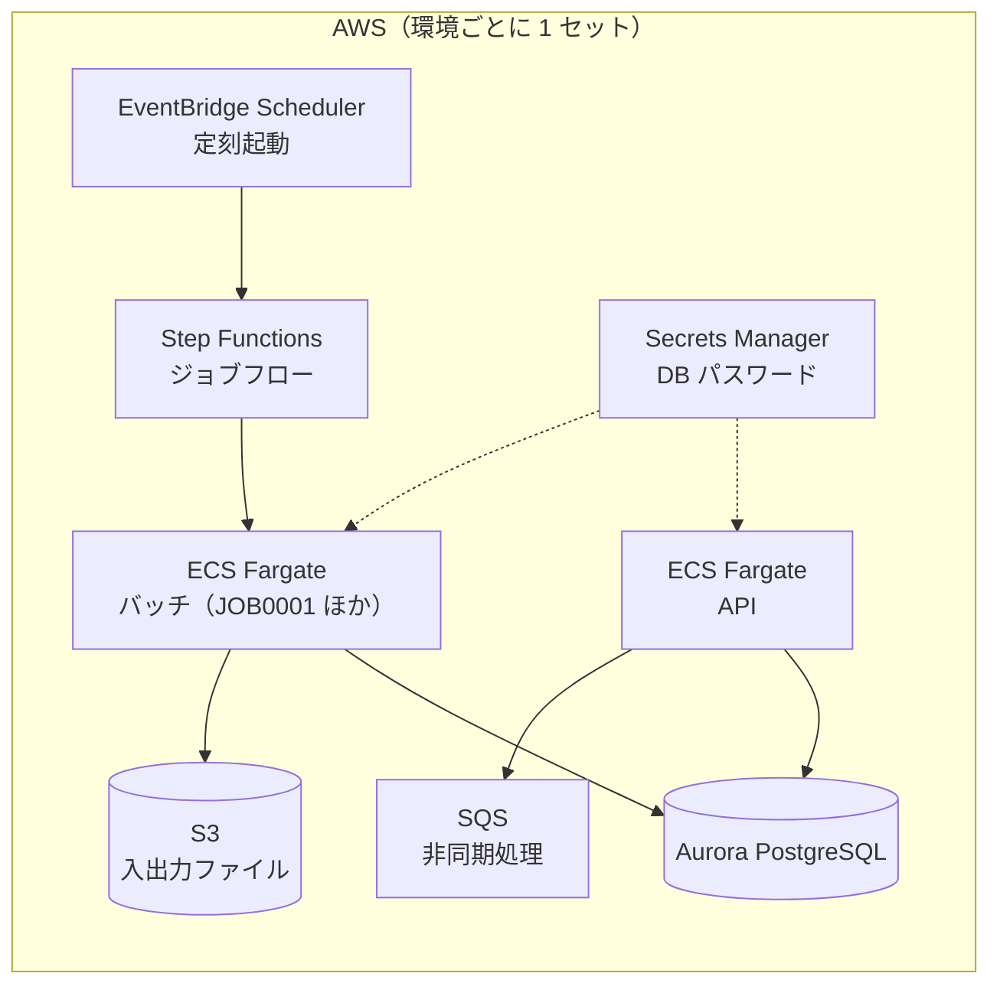

# 70-02 アーキテクチャ設計の基礎

!!! abstract "到達目標"
    - 可用性・拡張性・性能・セキュリティ・コストの 5 つの観点で、構成を評価できる
    - 構成図から単一障害点を見つけ、対策か「許容する」合意のどちらが必要かを説明できる
    - ステートレス・疎結合・障害を前提にした設計が、なぜ必要かを説明できる
    - 設計の判断を ADR（設計判断の記録）として書ける

## 何か

**アーキテクチャ** は、システムを構成する部品と、そのつながり方です。
**アーキテクチャ設計** は、非機能要件を満たすように部品とつながり方を選び、
その選び方の理由を説明できるようにすることです。

正解の構成は 1 つではありません。
同じ要件でも、費用・チームの技術・期間によって、よい構成は変わります。
大切なのは「何を得るために、何をあきらめたか（トレードオフ）」を説明できることです。

設計は、次の 5 つの観点で評価します。

| 観点 | 意味 | 代表的な手段 |
| --- | --- | --- |
| 可用性 | 止まらない、止まってもすぐ戻る | 冗長化（複数台・複数の拠点）、死活監視、自動の切り替え |
| 拡張性 | 負荷に合わせて伸び縮みできる | 台数を増やす（スケールアウト）、ステートレス化 |
| 性能 | 速く応答する | キャッシュ、CDN、非同期化、読み取り専用の複製 |
| セキュリティ | 守れる、後から追える | 最小権限、多層防御、暗号化、監査ログ |
| コスト | 必要十分な費用で済む | 適正な大きさ、従量課金の活用、不要なものの削除 |

この章で使う用語を先にまとめます。

| 用語 | 意味 |
| --- | --- |
| 単一障害点（SPOF） | そこが 1 つ止まると、全体が止まる部品 |
| スケールアウト / スケールアップ | 台数を増やす / 1 台の性能を上げる |
| ステートレス | サーバーが状態（セッション・ファイル）を持たないこと |
| 疎結合 | 部品どうしが直接に依存しない。片方が遅くても、もう片方が止まらない |
| 冪等性 | 同じ処理を何回行っても、結果が 1 回のときと同じ（[40-02](../40-async/40-02-queue-retry-idempotency.md)） |
| ADR | Architecture Decision Record。設計判断を 1 件 1 枚で残す記録 |

## なぜ必要か

構成は、一度作るとなかなか変えられません。
DB の種類やネットワークの分け方は、データとアプリの両方に影響するからです。
リリース後に「1 台では足りなかった」と分かると、停止を伴う移行が必要になります。

また、構成の「理由」が残っていないと、後から来た人が判断できません。
「なぜ NAT ゲートウェイが無いのか」が分からないと、不要と思って消したり、
必要と思って足したりして、意図しない費用や障害につながります。

設計レビューで評価されるのは、構成図の見た目より「理由」です。
観点を持って構成を選び、理由を記録する習慣が、設計の力そのものです。

## どうやるか

### 単一障害点を探す

構成図の部品を 1 つずつ指さし、「これが止まったら何が起きるか」を問います。
全体が止まる部品が、単一障害点です。
見つけたら、次のどちらかにします。

- 冗長化する（2 台にする、2 つの拠点に置く）
- 止まってもよいと、要件として合意する（費用と止まる時間を示して）

### ステートレスにする

サーバーの中に、ログイン状態やアップロードされたファイルを置かないようにします。

!!! failure "悪い例"
    例: アップロードされた注文ファイルを、受け付けたサーバーのディスクに保存する。
    別のサーバーに振り分けられた処理からは、そのファイルが見えません。
    サーバーを減らすと、そのファイルも消えます。

!!! success "良い例"
    ファイルは S3 などの共有ストレージに、ログイン状態は DB やキャッシュに置く。
    どのサーバーが処理しても同じ結果になるので、台数を自由に増減できます。

### 疎結合にする

部品の間にキューや API をはさみ、直接の依存を減らします。
重い処理を同期で呼ぶと、相手が遅いだけで、呼ぶ側の応答も遅くなります。
キューに入れて非同期にすれば、相手が遅くても受け付けは止まりません。

### 障害を前提に設計する

クラウドでは、部品はいつか必ず壊れる、という前提で設計します。

| 手段 | 何をするか |
| --- | --- |
| タイムアウト | 相手の応答を待つ時間に上限を設ける |
| 再試行（リトライ） | 一時的な失敗なら、間隔を空けてやり直す |
| 冪等性 | やり直しても二重に登録されないようにする |
| サーキットブレーカー | 相手が壊れているときは、しばらく呼ぶのをやめる |
| デッドレターキュー | 何度やっても失敗するものを隔離し、後で調べる |

### データの整合性を選ぶ

ネットワークが分断されたとき、**一貫性**（どこから読んでも最新）と
**可用性**（とにかく応答する）を同時には守れません。
これを **CAP 定理** と呼びます。

| 整合性 | 意味 | 向いている例 |
| --- | --- | --- |
| 強い整合性 | 書いた直後に、誰が読んでも最新 | 残高、在庫の引き当て |
| 結果整合性 | 少し待てば最新になる | 「いいね」の数、検索の索引 |

RDB のトランザクション（ACID）は強い整合性です（[20-13](../20-basics/20-13-transaction.md)）。
キューを使った非同期処理は、結果整合性になります。

### 代表的なパターンを知る

| パターン | 概要 | 向いているとき | 注意点 |
| --- | --- | --- | --- |
| Web 3 層 | Web / アプリ / DB に分ける | 業務システムの大半 | DB が詰まりやすい |
| モノリス | 1 つのアプリにまとめる | 小〜中規模、少人数 | 大きくなると変更が怖くなる |
| マイクロサービス | 機能ごとに独立したサービス | 大規模、複数チームが独立して開発 | 運用・監視・分散トランザクションが難しい |
| イベント駆動 | 出来事を通知し、受け手が反応する | 非同期処理、システム間連携 | 順序と重複への対策が必要 |
| サーバーレス | 関数とマネージドサービスで作る | 負荷の波が大きい、小さな API | 実行時間の上限、特定のクラウドへの依存 |

迷ったら、**モジュールに分けたモノリスと、マネージドサービスの組み合わせ** から始めます。
マイクロサービスは、組織の規模が理由になるときに選びます。

### 設計判断を ADR に残す

ADR は「状況・決定・代替案・影響」を 1 件 1 枚で書きます。
例として、sample-app の dev1 環境に NAT ゲートウェイが無い理由を ADR にすると、次のようになります。

```markdown
# ADR-001: dev1 環境では NAT ゲートウェイを作らない

## 状況
dev1 は開発用の環境で、夜間・休日は使わない。NAT ゲートウェイは起動しているだけで費用がかかる。

## 決定
dev1 では NAT ゲートウェイを作らない（enable_nat_gateway = false）。
private サブネットから外部へ出る通信が必要になったら、VPC エンドポイントを追加する。

## 検討した代替案
- NAT ゲートウェイを作る: 本番と同じ構成になるが、費用が常にかかるため不採用
- アプリを public サブネットに置く: 外部から直接届く場所に置くことになるため不採用

## 影響
dev1 では、private サブネットからインターネットに出られない。
コンテナイメージの取得などに使う VPC エンドポイントを、別途用意する必要がある。
```

## サンプルアプリでは

dev-environment の `cloud/README.md` に、sample-app を AWS で動かすときの構成図があります。



この構成を、この章の観点で読みます。

| 観点 | 構成での表れ |
| --- | --- |
| ステートレス | ファイルは S3、DB のパスワードは Secrets Manager に置き、コンテナは状態を持たない |
| 疎結合 | API は重い処理を SQS に入れて非同期にする。失敗が続くとデッドレターキューへ |
| 障害を前提 | Step Functions が、ECS のタスク起動の一時的な失敗を 2 回まで再試行する |
| 可用性 | prod では API と DB を 2 台にしている |

再試行の設定は、`cloud/modules/batch-workflow/main.tf` にあります。

```hcl title="cloud/modules/batch-workflow/main.tf（66〜71 行目）"
        Retry = [{
          ErrorEquals     = ["ECS.AmazonECSException"]
          IntervalSeconds = 30
          MaxAttempts     = 2
          BackoffRate     = 2
        }]
```

30 秒後、次は 60 秒後と、間隔を倍にしながら 2 回まで再試行します（指数バックオフ）。
JOB0001 は登録済みの注文番号を飛ばすので、やり直しても二重登録になりません（[30-11](../30-reading/30-11-idempotent-insert.md)）。
再試行と冪等性が、セットで設計されています。

一方で、単一障害点も残っています。
`cloud/modules/network/main.tf` の NAT ゲートウェイです。

```hcl title="cloud/modules/network/main.tf（61〜66 行目）"
resource "aws_nat_gateway" "this" {
  count         = var.enable_nat_gateway ? 1 : 0
  allocation_id = aws_eip.nat[0].id
  subnet_id     = aws_subnet.public[0].id
  tags          = { Name = "${var.name}-nat" }
}
```

NAT ゲートウェイは、1 つ目の public サブネット（1 つ目の AZ）に 1 つだけ作られます。
その AZ が止まると、もう一方の AZ のアプリも外部へ出られなくなります。
prod の API と DB は 2 台なのに、外への出口は 1 つです。
これを直すか、許容するかを決めるのが、この章で学んだ「単一障害点への対応」です（理解度チェックの 4 問目）。

## もし設計の観点を持たなかったら？

ある業務システムで、アップロードされたファイルを Web サーバーのディスクに保存していました。
アクセスが増えたので、サーバーを 2 台にしました。
すると「アップロードしたはずのファイルが見つからない」という問い合わせが、半分の確率で届くようになりました。
2 台目のサーバーには、1 台目に保存したファイルが無いからです。

ステートレスという観点を知っていれば、最初から共有ストレージに置いていたはずです。
観点を持たずに作った構成は、規模が変わったときに初めて弱点が表に出ます。
そのときには、データの移行や停止を伴う大きな手直しが必要になります。

## 理解度チェック

1. スケールアップより、スケールアウトのほうがクラウドで好まれる理由を 2 つ答えてください。

    ??? note "答え"
        1 台の性能には上限があるが、台数は増やし続けられる点です。
        また、複数台にすると 1 台が止まっても動き続けられ、可用性も上がる点です。

2. 「Web サーバーを Auto Scaling で増減させたい」とき、事前にやるべきことは何ですか。

    ??? note "答え"
        ステートレスにすることです。
        セッションは DB やキャッシュに、ファイルは S3 などの共有ストレージに移します。

3. 注文の受付と在庫の引き当てを、キューで非同期にしたときの注意点を答えてください。

    ??? note "答え"
        結果整合性になる点です。受付の直後は、在庫にまだ反映されていない時間があります。
        また、キューは同じメッセージを 2 回届けることがあるので、受信処理を冪等にします。

4. sample-app の prod 環境の NAT ゲートウェイについて、対応を 2 案挙げてください。

    ??? note "答え"
        1 つ目は、AZ ごとに NAT ゲートウェイを作り、private サブネットの経路も AZ ごとに分ける案です。
        2 つ目は、外部へ出る必要のある通信（イメージ取得・S3 など）を VPC エンドポイントに移し、
        NAT ゲートウェイが止まっても業務が続くようにする案です。
        どちらも費用が増えるので、要件と比べて決め、ADR に残します。

5. ADR に「検討した代替案」を書く理由は何ですか。

    ??? note "答え"
        後から来た人が、同じ検討をやり直さずに済むようにするためです。
        また、状況が変わったとき（費用・規模）に、どの案に切り替えればよいかが分かります。

## コードを読むときの確認観点

- [ ] 構成の部品ごとに「1 つ止まったら何が起きるか」を説明できるか（単一障害点）
- [ ] アプリのサーバー（コンテナ）が、ファイルやセッションを中に持っていないか
- [ ] 外部の呼び出しに、タイムアウトと再試行の設定があるか
- [ ] 再試行される処理が、冪等になっているか
- [ ] 構成の重要な判断に、理由（ADR など）が残っているか
