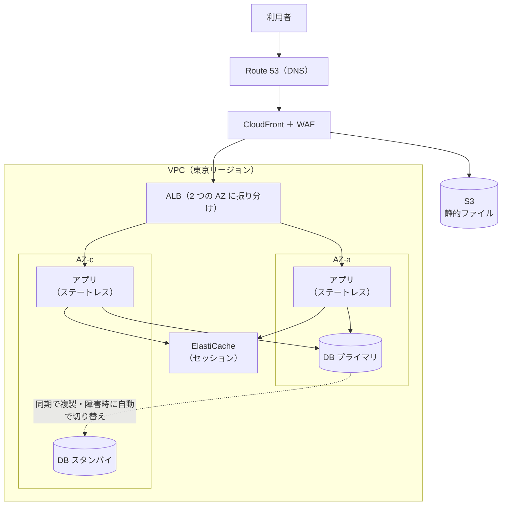

# 70-05 構成パターンと Well-Architected

!!! abstract "到達目標"
    - マルチ AZ の Web 3 層の構成を描き、各部品の役割を説明できる
    - 要件に合わせて、サーバーレス・非同期・静的サイトなどの変形パターンを選べる
    - Well-Architected フレームワークの 6 つの柱で、構成を評価できる
    - RTO / RPO と費用から、DR の 4 つの戦略のどれを使うかを選べる

## 何か

**構成パターン** は、よくある要件に対する、実績のある構成の型です。
最初に描けるようにするべきなのは、**マルチ AZ の Web 3 層** です。
多くの構成は、これを変形したものとして説明できます。



どちらの AZ が止まっても、残った側だけでサービスを続けられます。

**Well-Architected フレームワーク** は、AWS がまとめた「よい構成」の考え方です。
6 つの柱で、構成を評価します。

## なぜ必要か

毎回ゼロから構成を考えると、時間がかかるうえ、過去に誰かが踏んだ失敗を繰り返します。
型を知っていれば、「この要件ならこの型、この部分だけ変える」と速く正しく考えられます。

また、評価の軸が無いと、設計レビューが「好み」の言い合いになります。
Well-Architected の 6 つの柱を共通の言葉にすると、どこが弱いかを具体的に話せます。
資格試験の出題範囲も、この柱に沿っています。

## どうやるか

### 基本形の部品の役割

1. 利用者 → **Route 53**（DNS）→ **CloudFront**（配信。WAF で攻撃を防ぐ。静的ファイルは S3 から）
2. → **ALB**（public サブネット、2 つの AZ）
3. → アプリ（private サブネット、2 つの AZ、最低 2 台、ステートレス、自動で増減）
4. → **ElastiCache**（セッション・キャッシュ）
5. → **RDS / Aurora のマルチ AZ**（private サブネット。読み取りが多ければリードレプリカ）
6. 外へ出る通信は NAT ゲートウェイか VPC エンドポイント、操作の記録は CloudTrail

### 要件に合わせて変形する

| 要件 | 構成の変え方 |
| --- | --- |
| サーバーを管理したくない、負荷の波が大きい | API Gateway → Lambda → DynamoDB（サーバーレス） |
| コンテナで運用したい | ALB → ECS on Fargate |
| 重い処理で画面が固まる | 受付 → SQS → 処理役（非同期化） |
| 静的なサイト（LP、SPA） | S3 ＋ CloudFront（S3 は直接公開しない） |
| ファイルが置かれたら処理する | S3 のイベント → Lambda（または EventBridge） |
| 大量のデータを集計する | S3（データの置き場）→ Glue → Athena / Redshift |
| 社内のネットワークと一緒に使う | Direct Connect / VPN ＋ Transit Gateway |

### Well-Architected の 6 つの柱

| 柱 | 問うこと | 代表的な答え |
| --- | --- | --- |
| 運用上の優秀性 | 運用を自動化し、改善し続けられるか | IaC、小さく頻繁な変更、監視と手順書 |
| セキュリティ | 最小権限・多層防御・追跡ができるか | IAM ロール、暗号化、CloudTrail、GuardDuty |
| 信頼性 | 障害から自動で復旧できるか | マルチ AZ、自動の増減、バックアップ、DR |
| パフォーマンス効率 | 適切なリソースを選んでいるか | 適切な大きさ、キャッシュ、CDN、サーバーレス |
| コスト最適化 | むだなく払っているか | 適切な大きさ、Savings Plans、スポット、不要なものの削除 |
| 持続可能性 | 環境への負荷を減らしているか | 使用率を上げる、マネージドサービス、省電力の CPU（Graviton） |

AWS のコンソールにある **Well-Architected Tool** で、質問に答えながら自分の構成を評価できます。

### DR の 4 つの戦略

リージョン全体の障害に備えるのが DR（災害対策）です。
RTO / RPO が短いほど、費用は上がります（[70-01](70-01-requirements.md)）。

| 戦略 | 普段の状態 | RTO / RPO の目安 | 費用 |
| --- | --- | --- | --- |
| バックアップと復元 | バックアップだけを別のリージョンに置く | 時間〜日 | 最も安い |
| パイロットライト | DB など中心の部分だけを、別のリージョンで常に複製。サーバーは止めておく | 数十分〜時間 | 安い |
| ウォームスタンバイ | 小さくした環境を、別のリージョンで常に動かす | 分 | 中くらい |
| マルチサイト | 両方のリージョンで、全力で動かす | ほぼゼロ | 最も高い |

試験でも実務でも、「RTO / RPO を満たす中で、最も安い戦略」を選ぶ問題がよく出ます。

!!! failure "悪い例"
    要件は RTO 4 時間・RPO 1 時間なのに、「念のため」マルチサイトにする。
    費用は 2 倍以上になり、要件に対して過剰です。

!!! success "良い例"
    1 時間ごとに DB のスナップショットを大阪リージョンへ複製し、構成は IaC で用意しておく。
    障害時は IaC で環境を作り、スナップショットから DB を戻す（バックアップと復元）。
    復元の訓練をして、実際に 4 時間以内に戻せることを確かめておく。

### 費用を設計する

- 常に動くものは Savings Plans、変動する部分はオンデマンドと自動の増減、中断してよいものはスポット
- データ転送に注意する。インターネットへの送信、AZ をまたぐ通信、NAT ゲートウェイを通る通信は課金される
- S3 などへの通信は VPC エンドポイントを通すと、NAT ゲートウェイの費用を減らせる
- 開発環境は、夜間・休日に止める
- Cost Explorer で分析し、AWS Budgets でアラートを出し、タグでシステム別・環境別に分ける

## サンプルアプリでは

### 環境ごとの費用と信頼性のつり合い

`cloud/README.md` は、環境ごとの違いを次の表にまとめています。

| 環境 | NAT | DB 台数 | 削除保護 | API 台数 |
| --- | --- | --- | --- | --- |
| dev1 | なし（費用削減。外部アクセスが必要なら VPC エンドポイントを追加） | 1 | なし | 1 |
| stg | あり | 1 | あり | 1 |
| prod | あり | 2 | あり | 2 |

信頼性の柱は prod に、コスト最適化の柱は dev1 に寄せています。
README には、費用の抑え方として次のことも書かれています。

- dev 環境は、夜間・休日に API を 0 台にする
- 不要な環境は `terraform destroy` する

API の台数が 0 のときにサービス自体を作らない工夫が、`cloud/modules/ecs-service/main.tf` にあります。

```hcl title="cloud/modules/ecs-service/main.tf（97〜103 行目）"
resource "aws_ecs_service" "this" {
  count           = var.desired_count > 0 ? 1 : 0
  name            = var.name
  cluster         = var.cluster_arn
  task_definition = aws_ecs_task_definition.this.arn
  desired_count   = var.desired_count
  launch_type     = "FARGATE"
```

バッチは `desired_count = 0` で、常駐のサービスを作りません。
Step Functions が必要なときだけタスクを起動するので、動いている間だけ費用がかかります。

### prod 環境を 6 つの柱で評価する

| 柱 | できていること | 足りないこと（改善の候補） |
| --- | --- | --- |
| 運用上の優秀性 | Terraform で全環境を同じ構造で管理。本番はパイプライン経由で反映 | — |
| セキュリティ | private サブネット、タスクロール、Secrets Manager、S3 と DB の暗号化 | API とバッチが同じ権限を持つ（`data.aws_iam_policy_document.app` を共用） |
| 信頼性 | API と DB を 2 台、Step Functions の再試行、SQS のデッドレターキュー | NAT ゲートウェイが 1 つ（[70-02](70-02-architecture-basics.md)）。API の自動の増減が無い |
| パフォーマンス効率 | Fargate と Aurora で、大きさを後から変えられる | キャッシュが無い（必要かは負荷の要件しだい） |
| コスト最適化 | バッチは必要なときだけ起動 | S3 にライフサイクルルールが無い（[70-04](70-04-aws-services.md)） |
| 持続可能性 | マネージドサービスを中心に使う | — |

DR の観点では、Aurora の自動バックアップ（7 日分）は東京リージョンの中だけです。
リージョン全体の障害には、別のリージョンへのスナップショットの複製が必要です。
構成は Terraform で再現できるので、「バックアップと復元」の戦略の土台はできています。

`cloud/README.md` にあるとおり、ALB・WAF・CloudTrail などは、アカウント共通の基盤として別に管理する想定です。
評価するときは、このリポジトリの外にある部分も含めて考えます。

## もしパターンと評価の軸がなかったら？

あるチームが、Web サーバー 1 台と DB 1 台で本番をリリースしました。
最初は問題ありませんでしたが、利用者が増えると、毎朝の始業時に応答が遅くなりました。
サーバーを大きくしても足りず、DB にも負荷が集中していました。

Web 3 層の型を知っていれば、最初から ALB と自動の増減を前提に、ステートレスに作っていたはずです。
Well-Architected で評価していれば、リリース前に「信頼性」と「パフォーマンス効率」の弱さに気付けました。
型と軸は、経験の少ないうちほど、設計の抜けを防ぐ道具になります。

## 理解度チェック

1. マルチ AZ の Web 3 層で、ALB を public サブネット、アプリを private サブネットに置く理由は何ですか。

    ??? note "答え"
        外から直接に届く必要があるのは ALB だけだからです。
        アプリを private に置くと、ALB を通らない通信は届かず、攻撃を受ける面が小さくなります。

2. 要件が「RTO 4 時間、RPO 1 時間、費用は最小」のとき、どの DR 戦略を選びますか。

    ??? note "答え"
        バックアップと復元です。
        1 時間ごとのスナップショットを別のリージョンへ複製し、IaC で 4 時間以内に作り直せれば要件を満たします。
        最も安い戦略なので、「費用は最小」にも合います。

3. 要件が「RTO 10 分、RPO ほぼゼロ」のときは、どの戦略が候補ですか。

    ??? note "答え"
        ウォームスタンバイ（DB はリージョン間で常に複製）か、マルチサイトです。
        バックアップと復元やパイロットライトでは、10 分以内の復旧は難しいからです。

4. sample-app の prod 環境で、API とバッチが同じ IAM ポリシーを共用していることの問題と、直し方を答えてください。

    ??? note "答え"
        API は SQS の送信だけで足りるのに、S3 の読み書きもできてしまう点です（最小権限に反する）。
        API 用とバッチ用に、必要な操作だけのポリシーを分けて `task_policy_json` に渡します。

5. 開発環境の費用を下げる方法を 3 つ挙げてください。

    ??? note "答え"
        例: 夜間・休日に台数を 0 にする、NAT ゲートウェイを作らず VPC エンドポイントを使う、
        使わない環境は削除する（IaC なら、すぐに作り直せる）。

## コードを読むときの確認観点

- [ ] 構成が 6 つの柱のどれを優先しているか、説明できるか
- [ ] 本番と開発で、台数・削除保護・NAT の有無などの違いが意図どおりか
- [ ] DR の戦略が決まっていて、バックアップが別のリージョンにもあるか
- [ ] 復元の手順が書かれていて、訓練したことがあるか
- [ ] 常に動いているリソースと、必要なときだけ動くリソースが分けられているか
- [ ] タグ・予算のアラートで、環境ごとの費用を追えるか
