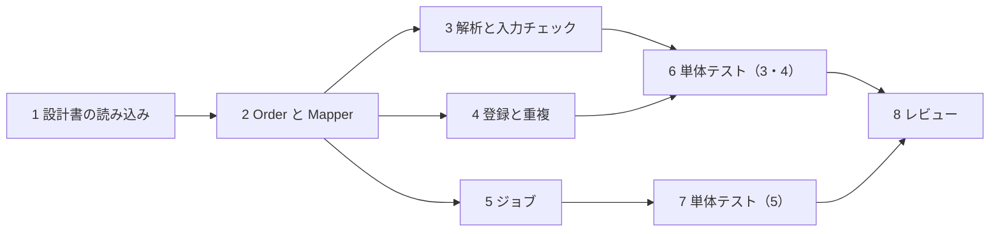

# 80-02 要員計画とスケジュール

!!! abstract "到達目標"
    - 工程を大工程・中工程・小工程に分解し、小工程を担当と期限の付く大きさにできる
    - 作業の前後関係（依存）を洗い出し、遅れると全体が遅れる作業の並び（クリティカルパス）を言える
    - 見積と要員の数から、要員の山積みを作って偏りを直せる
    - スケジュールに、レビュー・手戻り・待ちの時間を入れる理由を説明できる

## 何か

**要員計画** は、だれが・いつから・どれだけの時間を案件に使うかの計画です。
**スケジュール** は、作業をいつ始めて、いつ終えるかの計画です。

工程は、次のように段階を付けて分解します。

| 段階 | 例 | 粒度の目安 |
|---|---|---|
| 大工程 | 設計・製造・試験 | 数週〜数か月 |
| 中工程 | 詳細設計・実装・単体試験・結合試験 | 1〜数週 |
| 小工程 | 「注文取込の入力チェックを実装する」「重複のテストを書く」 | 0.5〜2 日 |

小工程は、**担当者が 1 人に決まり、終わったかどうかを誰が見ても判断できる** 大きさにします。
課題管理のツールに、課題（チケット）として 1 件ずつ登録する単位です。

## なぜ必要か

作業担当は、与えられたスケジュールの中で、自分の作業を期限までに終えれば十分です。
案件担当は、そのスケジュールを自分で作ります。

中工程のまま進めると、進み具合が「実装中」としか言えません。
1 週間たっても「まだ実装中」なら、順調なのか遅れているのか、だれにも分かりません。
小工程に分けておけば、「10 個中 4 個が完了、予定は 5 個」と数えられます。
これが [80-03](80-03-progress-escalation.md) で扱う進捗の可視化の土台になります。

要員計画が無いと、1 人に作業が集中し、他の人が待つことになります。
集中した人が休んだだけで、案件全体が止まります。

## どうやるか

### 1. 中工程を小工程に分解する

中工程ごとに、作る成果物と、確かめる作業を書き出します。

!!! failure "悪い例"
    ```text
    実装（注文取込バッチ） 10 日  担当: Aさん
    ```
    中身が 1 行で、途中の進み具合を測れません。

!!! success "良い例"
    ```text
    実装（注文取込バッチ）
      1. 設計書の読み込みと質問の整理        0.5 日  Aさん
      2. Order と Mapper（インタフェースと XML）  1 日  Aさん
      3. 1 行の解析と入力チェック               1.5 日  Aさん
      4. 登録・重複・内容の違う重複              1.5 日  Aさん
      5. ジョブ（引数・ログ・終了コード）          1 日  Bさん
      6. 単体テスト（3・4 の分）                 2 日  Aさん
      7. 単体テスト（5 の分）                    1 日  Bさん
      8. レビューと指摘の対応                    1.5 日  Aさん・Bさん
    ```
    1 番目に「設計書を読む」小工程を入れています。読む時間を計画に入れると、質問を早く出せます。

### 2. 依存関係とクリティカルパスを見る

小工程の前後関係を書きます。
「2 が終わらないと 4 を始められない」のような関係です。



最も長くかかる並び（クリティカルパス）は、1 → 2 → 4 → 6 → 8 です（0.5 + 1 + 1.5 + 2 + 1.5 = 6.5 日）。
この並びの作業が 1 日遅れると、全体が 1 日遅れます。
5 と 7 は余裕があるので、遅れても全体には響きにくい作業です。

### 3. 要員の山積みを作る

担当者ごと・日ごとに、割り当てた工数を積みます。

| 担当 | 1 日目 | 2 日目 | 3 日目 | 4 日目 | 5 日目 |
|---|---|---|---|---|---|
| Aさん | 1・2 | 2・3 | 3・4 | 4 | 6 |
| Bさん | （待ち） | 5 | 5 | 7 | （空き） |

Bさんの 1 日目は、2 が終わるまで 5 を始められず待っています。
この場合、Bさんに 1（設計書の読み込み）を一緒にしてもらう、テストデータを先に作ってもらう、などで偏りをならします。

### 4. 待ちと手戻りを入れる

スケジュールには、作業そのもの以外の時間も入れます。

- レビューを待つ時間と、指摘を直す時間
- 質問の回答を待つ時間（相手が他のチームなら、さらに長くなる）
- 環境の準備、他の案件の作業、休み

!!! warning "全員を 100% で積まない"
    1 人の 1 日を 100% 作業で埋めると、会議や問い合わせの分だけ必ず遅れます。
    チームの実績から、作業に使える割合（例: 7〜8 割）を決めて積みます。

## サンプルアプリでは

小工程に分けるときは、ソースの構成がそのまま手がかりになります。
注文取込バッチは、役割ごとにクラスが分かれています。

| 小工程 | ファイル |
|---|---|
| データの入れ物 | `sample-app/src/main/java/com/example/sample/order/Order.java` |
| SQL | `sample-app/src/main/java/com/example/sample/order/OrderMapper.java`・`sample-app/src/main/resources/mapper/OrderMapper.xml` |
| 業務ロジック | `sample-app/src/main/java/com/example/sample/order/OrderImportService.java` |
| ジョブ | `sample-app/src/main/java/com/example/sample/order/batch/OrderImportJob.java` |
| ファイルの取得 | `sample-app/src/main/java/com/example/sample/order/batch/DefaultFileFetcher.java` |

ジョブは、業務ロジックとファイルの取得を、インタフェース越しに受け取ります。

<!-- src: sample-app/src/main/java/com/example/sample/order/batch/OrderImportJob.java @main -->
```java
public OrderImportJob(FileFetcher fetcher, OrderImportService service) {
    this.fetcher = fetcher;
    this.service = service;
}
```

`FileFetcher` はインタフェースなので、`DefaultFileFetcher` の完成を待たずに、ジョブとそのテストを作り始められます。
`OrderImportJobTest.java` は、実際に偽物の `FileFetcher` を渡してテストしています。
このように、依存をインタフェースで切ってあると、小工程を並行して進めやすくなります。

## もし小工程への分解がなかったら？

「実装 10 日」のまま進めると、9 日目まで遅れに気づけません。
9 日目に「あと 5 日かかる」と分かっても、取れる手はほとんど残っていません。

小工程に分けてあれば、3 日目に「予定の 4 個に対して 2 個」と分かります。
その時点なら、担当の入れ替え、範囲の調整、期限の相談のどれも間に合います。

## 理解度チェック

1. 小工程の大きさを 0.5〜2 日にする理由は何ですか。
2. クリティカルパスの上にある作業が遅れると、何が起きますか。
3. 山積みで、ある人の日に「待ち」が出ています。どんな手が考えられますか。
4. 1 人の 1 日を 100% 作業で埋めない理由は何ですか。

??? note "答え"
    1. 担当を 1 人に決められ、終わったかを判断しやすく、遅れに数日以内で気づけるからです。
    2. その遅れの分だけ、案件全体の終わりが遅れます。
    3. 前提の作業を一緒に進める、先にできる作業（テストデータの準備など）を回す、他の人の作業と入れ替える、などです。
    4. 会議・問い合わせ・レビューなど、作業以外の時間が必ずあるからです。全部を作業で埋めると、必ず遅れます。

## コードを読むときの確認観点

- [ ] クラスの役割の分かれ方が、小工程の分け方の手がかりになっているか
- [ ] インタフェースで依存が切られていて、並行して作れる部分があるか
- [ ] 1 つの小工程で直すファイルが、多すぎないか（多ければ分ける）
- [ ] テストを書く作業が、実装の小工程と別に計画されているか

## 演習

1. sample-app の会員 API に「会員の名前を変更する API」を足すとします。
   中工程「実装」と「単体試験」を、それぞれ 3 つ以上の小工程に分け、工数を付けてください。
2. 演習 1 の小工程の依存関係を書き、クリティカルパスを答えてください。
3. 演習 1 を 2 人で進めるとき、山積みの表を作り、待ちが出ないように割り当ててください。

解答: [80-02 解答](answers/80-02.md)
