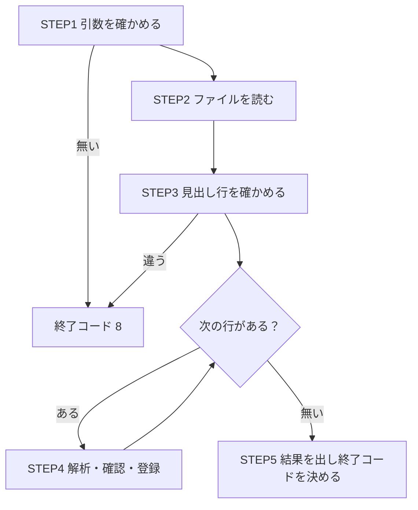

# 80-06 設計書を読み、改善を提案する

!!! abstract "到達目標"
    - 設計書の各 STEP について、「処理内容」と「処理目的」を自分の言葉で書き出せる
    - ループと条件分岐を含む処理の流れを、図や箇条書きで説明できる
    - 環境ごとに変わる値の置き場所や、処理の順番の不備を見つけられる
    - 改善の提案を、現状・問題・提案・根拠・影響の形で出せる

## 何か

設計書の **処理フロー** は、処理を STEP（手順）に分けて、順に書いたものです。
各 STEP について、2 つのことを読み取ります。

| 読み取ること | 問い | 例 |
|---|---|---|
| 処理内容 | 何をするか | 1 行ずつ、会員 ID の会員が存在するかを確かめる |
| 処理目的 | なぜするか | 存在しない会員の注文を登録すると、外部キー違反でファイル全体の取込が取り消されるため |

処理内容は設計書に書いてあります。
処理目的は、書いていないことが多く、自分で考える必要があります。

## なぜ必要か

作業担当は、処理フローのとおりにコードを書ければ十分です。
案件担当は、各 STEP の役割を説明でき、設計の不備に気づいて提案できる必要があります。

処理目的が分からないまま作ると、次のことが起きます。

- 設計書に書いていない場面（0 件・重複・異常）で、どう動くべきかを判断できない
- 設計書の誤りや矛盾を、そのまま実装してしまう
- 後で仕様が変わったとき、どの STEP に影響するかが分からない

目的を書き出すと、「この STEP の目的が書けない」箇所が見つかります。
そこが、質問すべき点か、設計の不備です。

## どうやるか

### 1. 実装に入る前に、読む時間を取る

設計書を読む時間を、スケジュールの小工程として入れます（[80-02](80-02-schedule.md)）。
読みながら、次の表を埋めます。

| STEP | 処理内容（自分の言葉で） | 処理目的（自分の言葉で） | 分岐・ループ | 疑問 |
|---|---|---|---|---|
| 1 | | | | |

「疑問」の列が埋まったら、まとめて設計者に質問します。
1 件ずつ聞くより、相手の時間を取りません。

### 2. 流れを図にする

ループと条件分岐は、文章だけだと読み違えやすい部分です。
簡単な図にすると、「どの条件で、どの STEP に進むか」の漏れに気づけます。



### 3. 不備を探す観点

目的を書き出しながら、次の観点で不備を探します。

| 観点 | 問い |
|---|---|
| 処理の順番 | ある STEP が使う値は、それより前の STEP で作られているか |
| 環境ごとに変わる値 | 接続先・ファイルの場所・上限値などが、どこに置かれているか |
| 目的の重複 | 同じ確認を 2 か所でしていないか（していれば、片方を消せるか） |
| 例外の扱い | 各 STEP が失敗したとき、どうなるか書かれているか |

### 4. 改善を提案する

!!! failure "悪い例"
    「出力先の場所はマスタに入れない方がいいと思います。」
    なぜなのか、どこに置けばよいのか、変えると何に影響するのかが分かりません。

!!! success "良い例"
    ```text
    【現状】STEP2 で、出力先の場所をマスタテーブル（設定値の表）から読む。
            値は環境ごとに別の DML（データを入れる SQL）で登録する。
    【問題】環境ごとの DML の管理が漏れると、検証環境のジョブが本番の場所に書く、などの事故になる。
            値を変えるたびに、DB へのデータの反映が要る。コードのレビューで値を確かめられない。
    【提案】出力先の場所を application.yml のプロパティにし、環境ごとの値は
            プロファイル別の設定ファイルか環境変数で与える。コードは @Value で受け取る。
    【根拠】接続先などの環境依存の値は、設定ファイル 1 か所に集めて管理できる
            （Spring Boot の外部化された設定）。sample-app も S3 の接続先をこの形で切り替えている。
    【影響】STEP2 の読み込み方、マスタの DML（削除）、環境ごとの設定、起動の手順書。
    ```

!!! note "マスタに置くべき値もある"
    業務の担当者が画面から変える値（商品の区分、税率の適用日など）は、マスタに置くのが自然です。
    「環境ごとに変わる」値は設定ファイル、「業務の都合で変わる」値はマスタ、と分けて考えます。

設定ファイルの仕組みは [20-08 設定とプロファイル](../20-basics/20-08-config-profile.md) で学びました。
外部化された設定の優先順位は、公式の [Externalized Configuration（Spring Boot）](https://docs.spring.io/spring-boot/reference/features/external-config.html) にあります。

## サンプルアプリでは

注文取込バッチ（JOB0001）を、上の図の 5 つの STEP に分けて読みます。
STEP1 は、`OrderImportJob.run` の最初で引数を確かめる部分です。

<!-- src: sample-app/src/main/java/com/example/sample/order/batch/OrderImportJob.java @main -->
```java
List<String> input = args.getOptionValues("input");
if (input == null || input.size() != 1) {
    log.error("{} JOB0001 引数 --input=<s3://バケット/キー またはファイル> が必要です", MessageIds.BATCH_INVALID_ARGS);
    exitCode = ERROR;
    return;
}
```

STEP4 は、`OrderImportService.importLines` のループの中です。会員の存在を確かめる部分を見ます。

<!-- src: sample-app/src/main/java/com/example/sample/order/OrderImportService.java @main -->
```java
if (!memberCache.computeIfAbsent(order.memberId(), mapper::memberExists)) {
    errors.add(lineNo + ": member_id の会員が存在しません（" + order.memberId() + "）");
    continue;
}
```

処理内容は「会員が存在しなければ、その行をエラーとして飛ばす」です。
処理目的は、`OrderMapper.java` の Javadoc に書かれています。

<!-- src: sample-app/src/main/java/com/example/sample/order/OrderMapper.java @main -->
```java
/** 会員が存在するか（外部キー違反で取込全体が取り消されないよう、登録の前に確かめる）. */
boolean memberExists(long memberId);
```

`memberCache` の目的は、同じ会員の確認を何度も DB に問い合わせないことです。
このように、1 つの STEP の中にも、目的の違う処理が複数入っていることがあります。

環境ごとに変わる値の置き方の例として、S3 の接続先があります。
`sample-app/src/main/resources/application-local.yml` では、ローカルのときだけエミュレータに向けています。

<!-- src: sample-app/src/main/resources/application-local.yml @main -->
```yaml
app:
  s3:
    endpoint: ${S3_ENDPOINT:http://localhost:9090}
```

接続先の値は、マスタにもコードにも書かず、設定ファイルと環境変数の 1 か所で決めています。

## もし処理目的の書き出しがなかったら？

「会員の存在を確かめる」STEP を、「外部キーがあるので DB が弾いてくれる、確認は要らない」と判断して省いたとします。
存在しない会員の行が 1 行あるだけで、DB の例外でファイル全体が取り消されます。
目的（全体を取り消させない）を知っていれば、この STEP を省いてはいけないと分かります。

処理の順番の不備も、目的を考えないと見逃します。
「集計日を決める」STEP が「集計日でデータを絞る」STEP より後にあっても、書かれたとおりに作れば、
空の集計日で絞ることになり、テストで初めて気づくことになります。

## 理解度チェック

1. 処理内容と処理目的の違いを、例を挙げて説明してください。
2. 処理目的を書き出すと、どんな箇所が見つかりますか。
3. 環境ごとに変わる値と、業務の都合で変わる値は、それぞれどこに置くのが自然ですか。
4. 改善の提案に「影響」を書く理由は何ですか。

??? note "答え"
    1. 処理内容は何をするか（例: 会員の存在を確かめる）、処理目的はなぜするか（例: 外部キー違反で取込全体が取り消されないため）です。
    2. 目的が書けない STEP です。質問すべき点か、設計の不備（不要な処理、順番の誤り）の候補です。
    3. 環境ごとに変わる値は設定ファイルと環境変数、業務の都合で変わる値はマスタです。
    4. 提案を受ける人が、変えたときの作業量と危険を判断できるようにするためです。

## コードを読むときの確認観点

- [ ] 各 STEP がコードのどこに当たるかを、指で差せるか
- [ ] 各 STEP の処理目的を、コメントや Javadoc から読み取れるか（無ければ自分で書けるか）
- [ ] ある処理が使う値は、それより前で作られているか
- [ ] 接続先・場所・上限などの値が、コードやマスタに直接書かれていないか

## 演習

1. JOB0001 の STEP1〜STEP5（上の図）について、「処理内容」と「処理目的」の表を埋めてください。
   コードは `OrderImportJob.java` と `OrderImportService.java` を読みます。
2. 次の架空の設計書を読み、各 STEP の処理内容と処理目的を書き出してください。
   そのうえで、設計の不備を 2 つ見つけ、改善の提案を「現状・問題・提案・根拠・影響」の形で書いてください。

    ```text
    ジョブ: 注文集計ファイル出力（架空）
    STEP1 起動引数から実行モード（通常 / 再実行）を受け取る。
    STEP2 マスタテーブル app_setting から、出力先の場所（output_location）を読む。
          app_setting の値は、開発・検証・本番の環境ごとに別の DML で登録する。
    STEP3 orders テーブルから、集計日の注文を商品コードごとに集計する。
    STEP4 集計日を決める。通常は実行日の前日。再実行のときは起動引数の日付。
    STEP5 集計結果を CSV にし、出力先の場所に書き出す。
    STEP6 出力した件数をログに出し、終了する。
    ```

解答: [80-06 解答](answers/80-06.md)
