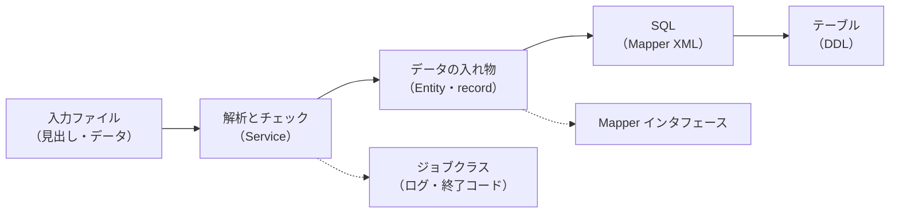

# 80-07 設計書とコードの対応と変更の影響範囲

!!! abstract "到達目標"
    - ジョブの入力・処理・出力を説明し、設計書の STEP とコードの該当箇所を対応づけられる
    - 処理に渡す値が、設定ファイル・変数・定数のどれから来るかを説明できる
    - 設定値が変わったときに影響を受ける箇所を挙げられる
    - インタフェース（IF）の項目を足すときに直す箇所を、モジュール単位で漏れなく挙げられる

## 何か

**設計書とコードの対応** は、設計書の各 STEP や項目が、コードのどこで実現されているかの対応のことです。
**影響範囲** は、ある変更をしたときに、直す必要がある・動きが変わる箇所の全体です。

ここでの **インタフェース（IF）** は、システムの外とやり取りするデータの形のことです。
注文取込バッチなら、入力の CSV の列（`order_no,member_id,product_code,quantity`）が IF です。

処理に渡す値の出どころは、次の 3 種類に分けられます。

| 出どころ | 例 | 変えるとき |
|---|---|---|
| 設定ファイル（`application.yml` など） | 入力の大きさの上限、S3 の接続先 | 設定と環境変数を変える。コードは変えない |
| 変数（実行時に決まる値） | 起動引数の入力の場所、CSV の各行の値 | 起動の手順や入力のデータが変わる |
| 定数（コードに固定した値） | 見出し行、桁数の上限、ジョブ ID | コードを変えてビルドし直す |

## なぜ必要か

作業担当は、「この行を直して」と言われた箇所を直せれば十分です。
案件担当は、変更の依頼を受けたときに、直す箇所を自分で洗い出し、見積と計画に反映します。

影響範囲の洗い出しが漏れると、次のことが起きます。

- 見積が足りず、途中で作業が増える
- 1 か所だけ直して、他の箇所が古いまま残る（例: 入力チェックは直したが、DB の列が足りない）
- テストが足りず、変わったことに気づかないまま出荷する

## どうやるか

### 1. 入力→処理→出力を書く

まずジョブ全体を、入力・処理・出力の 3 つで書きます。

| 区分 | JOB0001 での中身 |
|---|---|
| 入力 | 起動引数 `--input`（S3 かローカルのファイル）、CSV の各行、DB の `member` テーブル |
| 処理 | 見出しの確認、1 行ずつの解析・チェック・登録、件数の集計 |
| 出力 | DB の `orders` テーブル、ログ（件数・エラーの行）、終了コード |

### 2. STEP とコードを対応づける

[80-06](80-06-read-design.md) で書いた STEP の表に、コードの場所の列を足します。
クラス名・メソッド名で書いておくと、行番号がずれても探せます。

### 3. 値の出どころをたどる

処理に渡す値を 1 つずつ選び、「どこから来たか」をさかのぼります。
IDE の「宣言へ移動」と「呼び出し元を表示」を使います。

### 4. 変更の影響をモジュール単位で洗い出す

IF の項目を足すときは、データの流れに沿って、次の層を順に確かめます。



「直す必要がない」と確かめた箇所も、表に「変更なし（確認済み）」と残します。
確かめたのか、見落としたのかを、レビューする人が区別できるようにするためです。

!!! tip "名前で検索する"
    項目名（`quantity` など）と、関係するクラス名・定数名でリポジトリ全体を検索すると、漏れを減らせます。
    テスト・テストデータ・手順書（README）も検索の対象に入れます。

## サンプルアプリでは

### 値の出どころの 3 種類

**設定ファイル**: 入力の大きさの上限は、`@Value` で設定から受け取り、無ければ既定値を使います。

<!-- src: sample-app/src/main/java/com/example/sample/order/batch/DefaultFileFetcher.java @main -->
```java
public DefaultFileFetcher(S3Client s3, @Value("${app.batch.max-input-bytes:" + DEFAULT_MAX_BYTES + "}") long maxBytes) {
```

この値を変えると、`DefaultFileFetcher` の上限の確認が変わります。
`local/README.md` の「取込の大きさとコミットの単位」には、上限を上げるときは JVM のメモリも増やすよう書かれています。
設定値 1 つの変更でも、影響はコードの外（起動の設定）にまで及びます。

**変数**: 入力の場所は、起動引数から受け取ります。

<!-- src: sample-app/src/main/java/com/example/sample/order/batch/OrderImportJob.java @main -->
```java
ImportResult r = service.importLines(fetcher.readLines(input.get(0)));
```

**定数**: 見出し行と桁数の上限は、コードに固定しています。

<!-- src: sample-app/src/main/java/com/example/sample/order/OrderImportService.java @main -->
```java
static final String HEADER = "order_no,member_id,product_code,quantity";

/** orders.order_no・orders.product_code の桁数（local/db/init/01_schema.sql の VARCHAR(20)）. */
static final int CODE_MAX_LENGTH = 20;
```

`CODE_MAX_LENGTH` のコメントに、DB の定義との対応が書かれています。
DB の桁を変えたら、この定数も変える必要があることが分かります。

### 1 行の解析

IF の項目は、`parse` で 1 列ずつ取り出されます。

<!-- src: sample-app/src/main/java/com/example/sample/order/OrderImportService.java @main -->
```java
static Order parse(String line) {
    List<String> cols = splitCsv(line);
    if (cols.size() != 4) {
        throw new IllegalArgumentException("列数が 4 ではありません（" + cols.size() + " 列）");
    }
    String orderNo = code(cols.get(0), "order_no");
    long memberId = parseLong(cols.get(1), "member_id");
    String product = code(cols.get(2), "product_code");
    long quantity = parseLong(cols.get(3), "quantity");
    if (quantity < 1 || quantity > 999) {
        throw new IllegalArgumentException("quantity は 1〜999 です（" + quantity + "）");
    }
    return new Order(orderNo, memberId, product, (int) quantity);
}
```

### 登録の SQL

<!-- src: sample-app/src/main/resources/mapper/OrderMapper.xml @main -->
```xml
<insert id="insertIfAbsent">
  INSERT INTO orders (order_no, member_id, product_code, quantity)
  VALUES (#{orderNo}, #{memberId}, #{productCode}, #{quantity})
  ON CONFLICT (order_no) DO NOTHING
</insert>
```

`#{orderNo}` などは、`Order` の部品（アクセサ）の名前と対応しています。
`Order` に項目を足しても、XML に `#{...}` を足さなければ、その項目は DB に入りません。
コンパイルは通るので、テストかレビューで気づく必要があります。

## もし影響範囲の洗い出しがなかったら？

「CSV に単価の列を足す」という依頼に、`parse` だけを直して終わったとします。
列数の確認は 5 列で通りますが、`Order` に単価が無いので、値は捨てられます。
DB にも列が無いので、エラーにもなりません。
単価が 1 件も登録されていないことに、本番の運用で初めて気づきます。

洗い出しの表があれば、「`Order` に足す」「XML に足す」「DDL に足す」が並び、1 つも抜けません。
見積も、その表から積み上げられます。

## 理解度チェック

1. 値の出どころが「設定ファイル」「変数」「定数」のとき、値を変えるのに必要な作業はそれぞれ何ですか。
2. `app.batch.max-input-bytes` を大きくするとき、コード以外に確かめることは何ですか。
3. `Order` に項目を足しても、Mapper XML を直さないと何が起きますか。
4. 影響範囲の表に「変更なし（確認済み）」を残す理由は何ですか。

??? note "答え"
    1. 設定ファイルは設定や環境変数を変える、変数は起動の手順や入力のデータを変える、定数はコードを変えてビルドし直す、です。
    2. JVM のメモリ（`-Xmx`、クラウドではタスクのメモリ）も増やす必要があるかです。ファイル全体をメモリに読むためです。
    3. その項目が DB に登録されません。コンパイルもエラーも起きないので、気づきにくい不具合になります。
    4. 確かめた結果として変更が要らないのか、見落としたのかを、レビューする人が区別できるようにするためです。

## コードを読むときの確認観点

- [ ] 処理に渡す値が、設定・変数・定数のどれから来るかを言えるか
- [ ] 定数の値が、DB の定義や設計書の値と対応づけてコメントされているか
- [ ] record（Entity）の項目と、Mapper XML の `#{...}`、テーブルの列が一致しているか
- [ ] 項目を足したときに、テストとテストデータも直す対象に入っているか

## 演習

1. JOB0001 の STEP1〜STEP5（[80-06](80-06-read-design.md) の図）について、コードの場所（クラス名・メソッド名）を対応づけてください。
2. 次の値の出どころを「設定ファイル」「変数」「定数」で答え、どこで決まるかを書いてください。
   (a) S3 の接続先 (b) 入力の場所 (c) 数量の上限 999 (d) ジョブ ID `JOB0001`
3. 入力の CSV に「単価（unit_price、1〜9,999,999 の整数）」の列を最後に足すとします。
   直す箇所を、モジュール単位（入力ファイル・Service・record・Mapper XML・Mapper インタフェース・ジョブクラス・DDL・テスト・手順書）で挙げてください。
   直さなくてよい箇所は、その理由も書いてください。

解答: [80-07 解答](answers/80-07.md)
